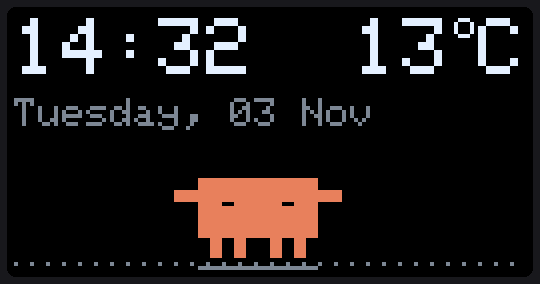
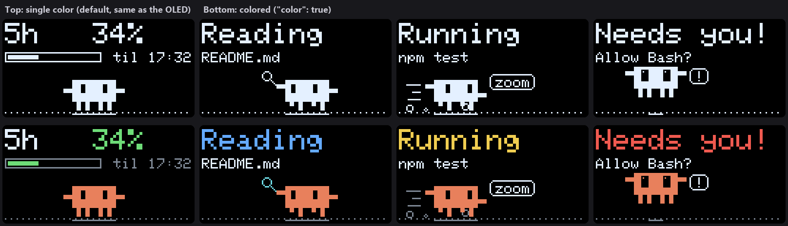
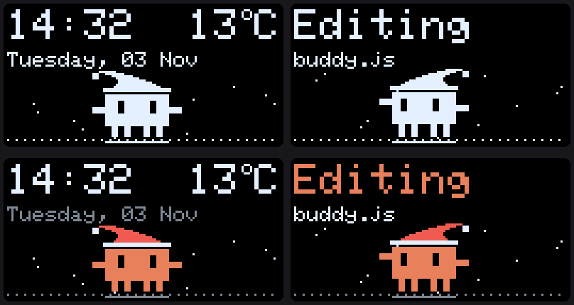

# ClawdBuddy

A tiny pixel critter that acts out what **Claude Code** is doing: it reads with a magnifying glass, hammers while editing, sprints while commands run, and jumps up and down when Claude needs your permission. It also shows your **Claude usage limits**, the **time**, the **temperature** and **how polluted the air is**, in plain words.

> Fan project. Not affiliated with or endorsed by Anthropic.

<p align="center">
  
</p>

<p align="center">
  
</p>

## Two versions: pick one or run both

| | 🖥️ Screen version | 🔌 ESP32 version |
|---|---|---|
| **What** | A small always-on-top window in the corner of your screen | A real 128×64 OLED gadget on your desk |
| **You need** | Python 3 + Edge or Chrome | ESP32 + SSD1306 OLED + a button (~$10) |
| **Setup time** | ~2 minutes | ~30 minutes (wiring + flashing) |
| **Controls** | mouse: click / double click / hold | button: tap / double tap / hold |

Both versions look and behave **exactly the same**. The screen version is a pixel-for-pixel port of the firmware. If you run both, they update together. The screen version can optionally be [colored](#colors-screen-version); the OLED is always single color.

**Setup:** everyone does [Step 1](#step-1-connect-claude-code-everyone), then [Step 2A](#step-2a-screen-version) for the screen version and/or [Step 2B](#step-2b-esp32-version) for the ESP32 version.

## What it shows

An **info card** on top (big text, slides to the next card every few seconds) and the **mascot's world** below.

| Card | Example |
|---|---|
| Time + weather | `14:32      13°C` / `Tuesday, 03 Nov` |
| Air quality | `Air: Fine` / `OK to air out` + pollution meter |
| 5-hour limit | `5h   10%` / progress bar, `til 12:50` |
| Weekly limit | `Week 52%` / progress bar, `Tue 16:00` |
| Claude activity | `Editing` / `ClawdBuddy.ino` (long text scrolls) |

Air quality is shown as **Clean → Fine → Hazy → Smog → Bad! → Toxic** with a hint like *"Open the windows"* or *"Windows shut!"* (based on US AQI from Open-Meteo).

## What the mascot does

| Claude Code is… | Mascot |
|---|---|
| thinking | wanders slowly, looks up, `...` bubble |
| reading files | strolls with a magnifying glass |
| searching (Grep/Glob) | hurries back and forth with the magnifier |
| editing / writing | hammers away, sparks fly |
| running commands | sprints with speed lines and dust, `zoom` |
| browsing the web | hops and looks around, `www` |
| running a subagent | walks with a mini-me following |
| waiting for permission | screen flashes, jumps with `!` |
| done | happy dance, scrolls Claude's last message |

Also: wears a [Santa hat](#christmas-mode) in the snow from December 1 to January 6 · wanders, hops, stretches and sits when idle · tired eyes at ≥70% usage, sweating at ≥90%, asleep at 100% · wears a mask when air is smoggy · dims and sleeps at night.

**Controls:** tap / click = hop (and dismiss the `!` alert) · double tap / double click = next card · hold = pet it ♥

---

## Step 1: Connect Claude Code (everyone)

You need Python 3 on the computer where you run Claude Code.

```bash
git clone https://github.com/eriknurgulde/ClawdBuddy.git
cd ClawdBuddy
python pc/install.py
```

This adds a status line and a few hooks to `~/.claude/settings.json` (a backup is saved first) and works for both versions. Restart Claude Code afterwards.

- The hooks run in the background (`"async": true`), so they never slow Claude down. If no buddy is running, the updates are silently dropped.
- To remove everything: `python pc/install.py --uninstall`

## Step 2A: Screen version

```bash
python web/webbuddy.py
```

A small window appears in the bottom-right corner, just above the taskbar, and stays on top of other windows. Close it to stop it.

**Start it automatically at login (Windows):**

```bash
python web/webbuddy.py --install-startup     # undo with --uninstall-startup
```

**Location, corner and size:** create `web/config.json`. Every field is optional:

```json
{ "place": "Berlin", "latitude": 52.52, "longitude": 13.40,
  "corner": "bottom-right", "scale": 3, "margin": 12, "margin_top": 12,
  "night_start": 23, "night_end": 7, "color": false, "christmas": "auto" }
```

`color` turns on [colors](#colors-screen-version). `christmas` is explained under [Christmas mode](#christmas-mode). `corner` can be `bottom-right`, `bottom-left`, `top-right` or `top-left`. `scale` 3 means each OLED pixel is 3×3 screen pixels. Pick a scale that gives whole pixels at your display scaling to keep it sharp: at 125%, use 1.6 or 2.4. `margin` is the gap to the screen edge. `margin_top` sets the top gap separately, e.g. `36` with `"corner": "top-right"` to sit just below the close/minimize buttons of maximized windows.

### Colors (screen version)

The screen version is single color by default, just like the OLED. To color it, add `"color": true` to `web/config.json` and reopen ClawdBuddy:

```json
{ "color": true }
```

Set it back to `false` (or remove the line) for single color. Colors only tint what's already drawn, so nothing else changes.

| Color | Means |
|---|---|
| 🟧 Orange | the mascot (and its mini-me) |
| 🟢 Green | usage below 70% · clean or fine air · **All done!** |
| 🟡 Yellow | usage 70–89% · hazy air · **Running** · 25°C or warmer · editing sparks |
| 🔴 Red | usage 90% or more · bad or toxic air · **Needs you!** · 32°C or warmer · Santa hat |
| 🟠 Amber | smoggy air |
| 🔵 Blue | **Reading** / **Searching** · below 5°C · sweat drops |
| 🩵 Cyan | **Thinking** / **Browsing** · magnifying glass · `Zz` |
| 🩷 Pink | **Delegating** (subagent) · the ♥ when you pet it |
| ⚪ Gray | dates, reset times, empty bars and meters, ground, dust, speed lines |
| ⚪ White | everything else: clock, labels, details, speech bubbles |

The usage number and its bar share a color, so you can read how close you are to the limit at a glance. Same for the air word and the pollution meter.

**macOS / Linux:** the always-on-top window is Windows-only for now. Run `python web/webbuddy.py --no-window` and open `http://127.0.0.1:8787` in your browser (an app window or pinned tab works well).

The local server only listens on `127.0.0.1:8787`, so nothing is exposed to your network.

## Step 2B: ESP32 version

### Parts

| Part | Notes |
|---|---|
| ESP32 dev board | any classic ESP32 (WROOM-32) |
| SSD1306 0.96" OLED, 128×64, I²C | address `0x3C` |
| Push button | or a TTP223 touch module |

### Wiring

| Module pin | ESP32 pin |
|---|---|
| OLED VCC / GND | 3V3 / GND |
| OLED SDA | GPIO 21 |
| OLED SCL | GPIO 22 |
| Button | GPIO 23 ↔ 3V3, **or** GPIO 23 ↔ GND (see `BUTTON_ACTIVE_LOW` below). No resistor needed. |
| *or* TTP223 VCC / GND / SIG | 3V3 / GND / GPIO 23 |

### Flash

1. Install the **esp32** board package (v3.x) in Arduino IDE.
2. Install libraries: **Adafruit SSD1306**, **Adafruit GFX**, **ArduinoJson** (v7).
3. Copy `config.example.h` to `config.h` and set:
   - your WiFi name and password (2.4 GHz only)
   - your location and timezone
   - `BUTTON_ACTIVE_LOW true` if your button goes to **GND** (`false` for 3V3 or a TTP223)

   `config.h` is git-ignored, so your password stays local.
4. Open `ClawdBuddy.ino`, select **ESP32 Dev Module**, upload.

On boot the screen shows `deskbuddy.local` and the board's IP address.

If `deskbuddy.local` doesn't resolve on your network, tell the scripts the IP in `~/.claude/settings.json`:

```json
"env": { "DESKBUDDY_HOST": "192.168.1.132" }
```

## Christmas mode

<p align="center">
  
</p>

ClawdBuddy puts on a Santa hat and it starts snowing. The hat's tip flips when he turns around, and on December 25th the date line says *Merry Christmas!* It works in single color, in color and on the OLED.

By default it turns on by itself from **December 1 to January 6**.

**Screen version:** set `"christmas"` in `web/config.json` to `"auto"` (default), `true` (always) or `false` (never). Or switch on the spot, even while it's running:

```bash
python web/webbuddy.py --christmas    # hat + snow
python web/webbuddy.py --regular      # back to normal
```

If ClawdBuddy is already open, these switch the running window instantly instead of opening a new one. Handy for two desktop shortcuts or `.bat` files.

**ESP32 version:** set `CHRISTMAS` in `config.h` to `2` (auto, default), `1` (always) or `0` (never), then upload again.

## Running only one version

`pc/deskbuddy.py` sends every update to both targets. Unreachable ones are skipped quickly, so this is optional, but you can switch one off in `~/.claude/settings.json`.

Screen version only (no ESP32):

```json
"env": { "DESKBUDDY_HOST": "off" }
```

ESP32 only (no screen version):

```json
"env": { "DESKBUDDY_WEB": "off" }
```

---

## How it works

```
                 status line (rate_limits)              ┌─► ESP32 board    (deskbuddy.local)
Claude Code ──── hooks (prompt, tools, stop…) ─► pc/deskbuddy.py ─┤
                                                        └─► screen version (127.0.0.1:8787)

Both fetch time + weather + air quality themselves (NTP / browser clock, Open-Meteo).
```

- **Usage limits** come from the official `rate_limits` field Claude Code passes to status line scripts (Pro/Max plans). The numbers are shared with the Claude apps, so the bars show your real total. They refresh whenever Claude Code is active; in between, the buddy counts down to the reset on its own.
- **Activity** comes from Claude Code hooks. Every network call has a 1 s timeout and failures are ignored.
- **Screen version** (`web/`): a JavaScript port of the firmware. It uses the same 128×64 1-bit frame buffer, the same Adafruit GFX drawing algorithms and font, and the same mascot logic. A small standard-library Python server (`webbuddy.py`) receives updates, streams them to the page, and pins an Edge/Chrome app window to the screen corner.
- **ESP32 version**: weather and air quality are fetched on the second core every 10 minutes, so animations never stutter.

### HTTP API

Both versions accept the same messages, which is handy for scripting or testing without Claude Code:

```bash
B=http://deskbuddy.local      # ESP32 version
B=http://127.0.0.1:8787       # screen version

curl -X POST $B/event -d '{"type":"working","task":"run","detail":"npm test"}'
curl -X POST $B/event -d '{"type":"waiting","detail":"Needs permission"}'
curl -X POST $B/usage -d '{"five_hour":{"used_percentage":42,"resets_at":1893456000}}'
curl $B/          # ESP32: status JSON
curl $B/state     # screen version: status JSON
```

`type`: `working` · `waiting` · `done` · `idle`
`task`: `think` · `read` · `search` · `edit` · `run` · `web` · `agent` · `tool`

## Troubleshooting

**Both versions**
- **Bars show `--`**: usage appears after Claude Code's first response in a session, and only on Pro/Max plans.
- **Status line**: a custom status line hides some footer hints in Claude Code (like `esc to interrupt`; Esc still works). If you already had a status line, `install.py` leaves it alone. Rerun it with `--replace-statusline` to use ClawdBuddy's.

**Screen version**
- **"Port 8787 is busy"**: it's already running (check the screen corners).
- **No window appears**: check `%LOCALAPPDATA%\ClawdBuddy\webbuddy.log`. Edge or Chrome must be installed.

**ESP32 version**
- **Nothing reacts**: open `http://deskbuddy.local/` in a browser. If it doesn't load, set `DESKBUDDY_HOST` to the IP shown on boot.
- **Button does nothing, or presses happen by themselves**: flip `BUTTON_ACTIVE_LOW` in `config.h`. `GET /` shows `button_presses` so you can check.
- **Clock is off**: check `TZ_INFO` in `config.h` (POSIX format, the sign is inverted: UTC+5 is `<+05>-5`).

## Fixes

- **Screen version stays above an auto-hiding taskbar:** Windows doesn't reserve space for a taskbar that auto-hides, so it used to slide up over the window. ClawdBuddy now keeps that space free.
- **Christmas mode:** Santa hat and snow, automatic from December 1 to January 6, with `--christmas` / `--regular` to switch the running window live (see [Christmas mode](#christmas-mode)).
- **Screen version can be colored:** `"color": true` in `web/config.json` tints usage, air quality, temperature and activity by meaning (see [Colors](#colors-screen-version)). Single color stays the default.
- **Screen version catches up when started mid-task:** opening ClawdBuddy while Claude Code is already busy now shows the current activity and usage bars immediately, instead of waiting for Claude's next action. `pc/deskbuddy.py` always saves the latest activity and usage, and `web/webbuddy.py` loads them on start.
- **Screen version never opens a second window:** starting it again while it's running does nothing. On Windows, the port wasn't claimed exclusively, so a second copy could start. A window left over from a stopped run is now reused instead of duplicated.
- **Screen version `margin_top` option:** places the window below the title-bar buttons of maximized windows so they stay clickable.
- **ESP32 version works with plain push buttons:** the button pin used to "float" without a resistor, causing phantom taps and long presses (a random ♥). It now uses the ESP32's internal pull-down, or pull-up with `BUTTON_ACTIVE_LOW`, plus 25 ms debouncing. `GET /` reports `button_presses` for checking the wiring.

## Credits

Hardware and input approach inspired by the [ESP32 OLED Desk Bot](https://github.com/Abaymelethil) by Abay Melethil (MIT).
The screen version embeds the classic 5x7 font from [Adafruit GFX](https://github.com/adafruit/Adafruit-GFX-Library) (BSD license).

## License

MIT
